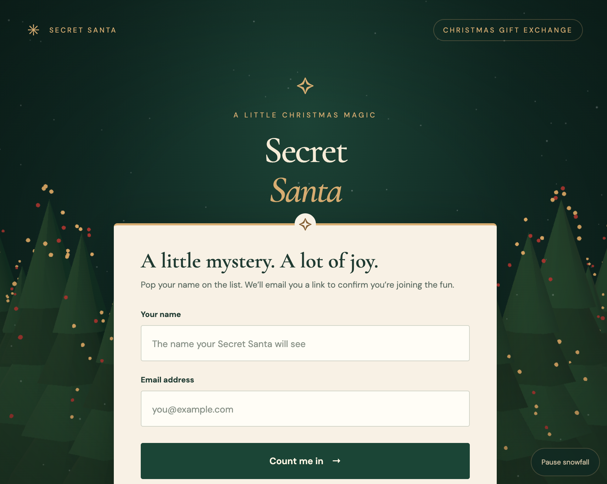

<hr>

A small Rust web app for family and team Secret Santa exchanges: email-confirmed signup, a private recipient reveal, and an admin page to close registration, shuffle confirmed participants, and send reveal emails. Data is stored in local JSON files; emails are sent through [Resend](https://resend.com).

## Configure and start

Requires Rust and Cargo. From the repository root:

```sh
cp .env.example .env  # first setup only
```

Edit `.env`:

- Set `GROUP_NAME` to your team or family name (quote values containing spaces).
- Set `SITE_ACCESS_TOKEN` and a different `ADMIN_ACCESS_TOKEN`. Generate each with `openssl rand -hex 32`.
- Set `PUBLIC_BASE_URL` to your public HTTPS origin, used for startup, sharing, and emailed links.
- To use an HTTPS domain as `PUBLIC_BASE_URL`, point its DNS at your server and run a reverse proxy such as Caddy in front of `127.0.0.1:3000`.
- For deployment, replace the example domain in `deploy/Caddyfile.example` and the signup page’s social preview URLs.
- Set `RESEND_API_KEY` and `EMAIL_FROM` (a verified [Resend](https://resend.com) sender) to enable emails.

Start the server:

```sh
set -a
source .env
set +a
cargo run
```

Startup prints copyable signup and admin links using `PUBLIC_BASE_URL`, plus a WhatsApp sharing link with `GROUP_NAME` and the public signup URL. For local access, use these URLs with the token values from `.env`:

- Signup: `http://127.0.0.1:3000/signup.html?token=<SITE_ACCESS_TOKEN>`
- Admin: `http://127.0.0.1:3000/admin.html?token=<ADMIN_ACCESS_TOKEN>`

Use the admin page to open/close registration, shuffle, then send emails. Registration locks after shuffling. Progress survives restarts.
